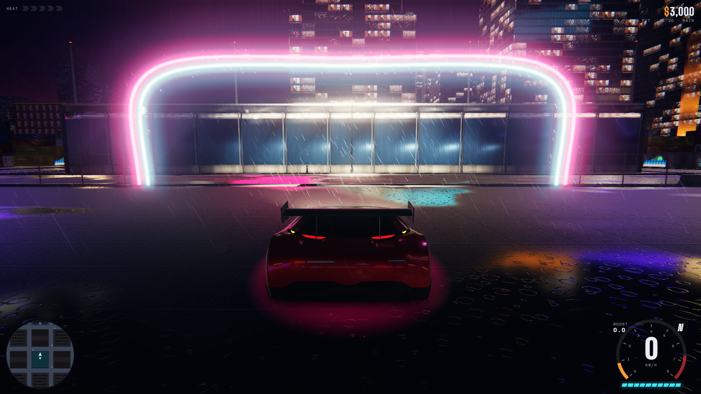

# Rainline

**A browser racing game set in a rain-soaked city.** Drive, drift and boost through neon streets, container docks and mountain switchbacks while outrunning the police.

[简体中文](README.md) · **English**

[Play online](https://mmotiy.github.io/rainline/) · [Performance report, in Chinese](docs/performance.md) · [Report an issue](https://github.com/mmotiy/rainline/issues)



## Features

- **City driving:** explore downtown Port Kessel, Saltyard Docks and Ridgeback Pass.
- **Events:** Ring Sprint, Saltyard Circuit, Ridgeback Run and the Plaza Drift Trial score challenge.
- **Police pursuits:** heat, pursuit, evasion and bust progress, with stronger pursuit units at higher heat levels.
- **Cars and garage:** buy vehicles, upgrade performance and customize paint, rims, underglow, spoilers and window tint.
- **Dynamic environment:** a day/night cycle, rain streaks, splashes, wet-surface reflections, neon bloom and dynamic shadows.
- **Local progress:** localStorage saves cars, cash, event results and settings, with additional local ghost replay data.

The current version is **single-player**. Traffic, opponents and police are computer-controlled; online multiplayer rooms have not been implemented.

## Play

1. Open the [game](https://mmotiy.github.io/rainline/) in a modern browser with WebGL2 support.
2. Wait for the city, vehicles, textures and physics engine to load, then select **Start engine**.
3. Open the map to find event markers. Approach one and press **E** to start an event or enter the garage.

Desktop Chrome or Edge with a keyboard or gamepad is the recommended starting point. Assets total approximately 50 MB, so first-load time depends on the connection. Touch controls are included, but comprehensive mobile compatibility and performance testing has not been completed.

Progress belongs to the current browser and site origin. It does not automatically sync between devices; clearing site data may remove saves.

### Controls

| Action | Keyboard | Standard-layout gamepad |
| --- | --- | --- |
| Throttle | W / ↑ | RT |
| Brake / reverse | S / ↓ | LT |
| Steer | A, D / ←, → | Left stick |
| Handbrake / drift | Space | A |
| Nitrous | Shift | B |
| Event / garage interaction | E | X |
| Change camera | C | Y |
| Map | M | Back / View |
| Reset car | R | LB |
| Pause | Esc | Start / Menu |

### Graphics

Four presets are available: **Ultra, High, Medium and Low**. Ultra includes ambient occlusion, SMAA, full view distances, 16,000 rain particles and a 4096 shadow map. Settings also cover rain, time of day, motion blur, camera shake, audio and the FPS display.

The existing adaptive resolution behavior remains enabled: heavy load can reduce the internal rendering resolution. Maximum effects do not guarantee 60 FPS on every GPU.

## Run locally

The project consists of static HTML, JavaScript and assets. **No bundler build or game backend is required.** With Python 3 installed, run this from the project root:

```sh
python -m http.server 8080 --bind 127.0.0.1
```

Open <http://127.0.0.1:8080/> and press `Ctrl+C` to stop the server. On Windows, `py -m http.server 8080 --bind 127.0.0.1` is another option.

Use HTTP rather than double-clicking `index.html`, because ES modules and asset loading can fail under file URLs. Three.js, Rapier and fonts currently load from external CDNs, so local play still requires an internet connection. If Rapier fails to load or initialize, the game attempts to use its built-in simplified physics implementation.

## Technology and layout

| Area | Implementation |
| --- | --- |
| 3D rendering | Three.js **0.170.0**, WebGL2 |
| Vehicle collision physics | Rapier **0.14.0**, with simplified physics fallback |
| Post-processing | GTAO, bloom, SMAA, motion blur and LUT color grading |
| City loading | Spatial cells, LOD, distant facade impostors, batching and instancing |
| Input and UI | Keyboard, Gamepad API, touch buttons, HTML/CSS HUD and Canvas maps |
| Saves and hosting | localStorage and GitHub Pages |

```text
index.html                    Entry point, gameplay, UI and scene logic
assets/                       Vehicles, city modules, HDRs and textures
city-batch.mjs                Grouped city culling and cached bounds
render-performance.mjs        Spatial index, GPU timing and shadow reuse helpers
tools/                        Unit tests and browser verification
docs/performance.md           First-round performance methodology and results
docs/images/                  Project screenshots
README.md                     Chinese documentation
README.en.md                  English documentation
```

## Rendering optimizations

- Conservative spatial groups are culled against each pass's own camera, preserving offscreen objects that cast visible shadows.
- Bounds are cached when instances load or slots are reused. Existing draw order, including transparent materials, is preserved.
- The AO normal pass reuses the main color pass's shadow map instead of drawing it again. Main-pass dynamic shadows still update every frame.
- Streaming checks nearby spatial buckets plus previously loaded cells, preserving LOD distances and unloading behavior.
- Asynchronous GPU timer queries distinguish GPU time from CPU rendering submission time.

First-round checks used an RTX 3080 at a fixed 1920×1080 resolution with Ultra effects. Seven fixed views were pixel-identical, and spatial cell checks decreased by approximately 85%. Average FPS in a short driving comparison was approximately 34.4 → 66.9.

These measurements compare **rendering optimizations disabled/enabled in the same version**. Both configurations use the spatial index; this is not an end-to-end comparison of complete old and new versions, and does not guarantee frame rates on lower-end GPUs. See the [report, in Chinese](docs/performance.md) for methodology, CPU costs and P99 frame intervals. WebGPU and Web Workers have not been integrated.

`city-batch.mjs` adapts internal BatchedMesh draw-list fields from Three.js r170. Revalidate culling, shadows, transparent materials and image parity before upgrading Three.js.

## Verification

With Node.js installed, run unit tests without additional dependencies:

```sh
node --test tools/streaming.test.mjs tools/gpu-timer.test.mjs
```

Browser verification requires the `playwright` package resolvable by Node.js and Windows Chrome installed at its default location:

```sh
npm install --no-save --package-lock=false playwright
node tools/performance-check.cjs
```

The script uses `C:/Program Files/Google/Chrome/Application/chrome.exe`; adjust the path for another installation or operating system. Checks cover pixel comparisons, GPU costs, cell states after preset changes and teleports, and continuous driving. Internal pixelRatio is fixed at 1 so resolution reductions cannot account for gains.

Reports and screenshots default to `rainline-perf` under the system temporary directory. Set `RAINLINE_QA_DIR` to choose another output directory. The script closes the server and browser it launches. Synchronized GPU samples of paused scenes are not gameplay FPS.

## GitHub Pages deployment

This repository publishes from the **root of the main branch**. Commit and push changes; GitHub then builds and deploys the Pages site. Check repository Actions for a successful deployment before using the updated online version.

Preserve the relative paths between `index.html`, the two `.mjs` files and `assets/`. GitHub Pages distributes static files; it does not provide a multiplayer game server.

## Asset credits and usage

The existing in-game credits identify these assets:

| Asset | Author / source | Stated license |
| --- | --- | --- |
| Car Concept | Eric Chadwick / Darmstadt Graphics Group | CC BY 4.0 |
| Toyota GR Supra GT300 | vecarz; livery removed in this version | CC BY 4.0 |
| Lighting HDRIs | Poly Haven | CC0 |
| City modules | Generated for Rainline | Not separately specified |

The repository does not currently declare a unified project license. Public availability does not grant unrestricted redistribution or commercial use of the code and all assets. Preserve applicable credits and verify original sources and license terms before reuse. The AI platform that originally generated the project has not been established, so no model or platform attribution is claimed.

For bug reports, include your browser version, GPU, viewport resolution, graphics preset, reproduction steps and relevant screenshots or console errors.
